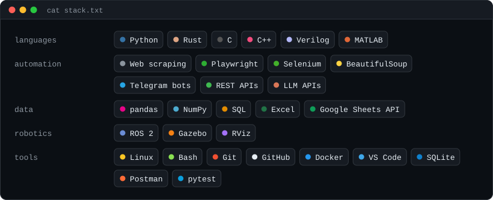
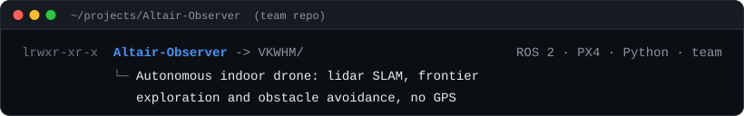
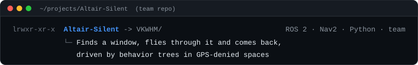
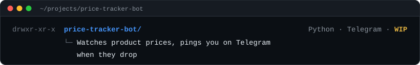
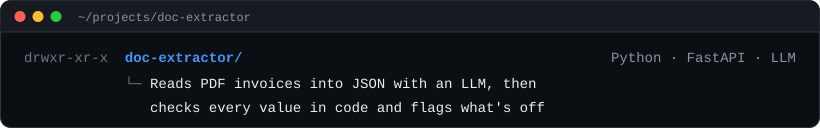
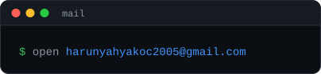
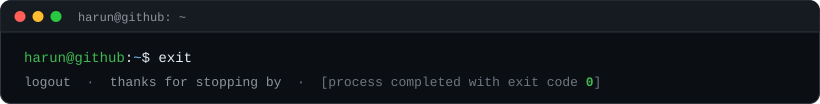

<!-- Section images live in ./assets. To change them, edit tools/make_svgs.py and run: python3 tools/make_svgs.py -->

  

  

  

  
  
  
  

  

  <picture>
    <source media="(prefers-color-scheme: dark)" srcset="https://raw.githubusercontent.com/harunk0c/harunk0c/output/github-snake-dark.svg">
    
  </picture>

  
  

  

